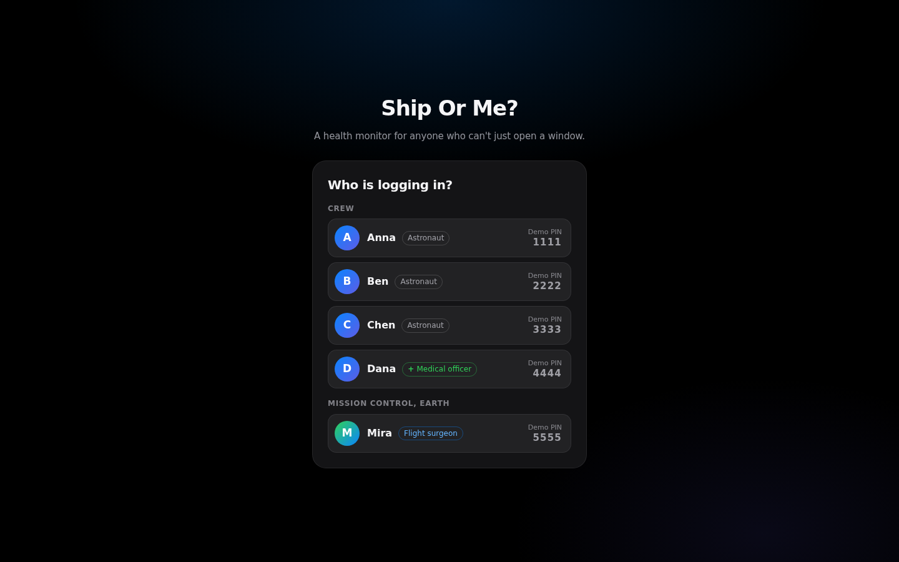
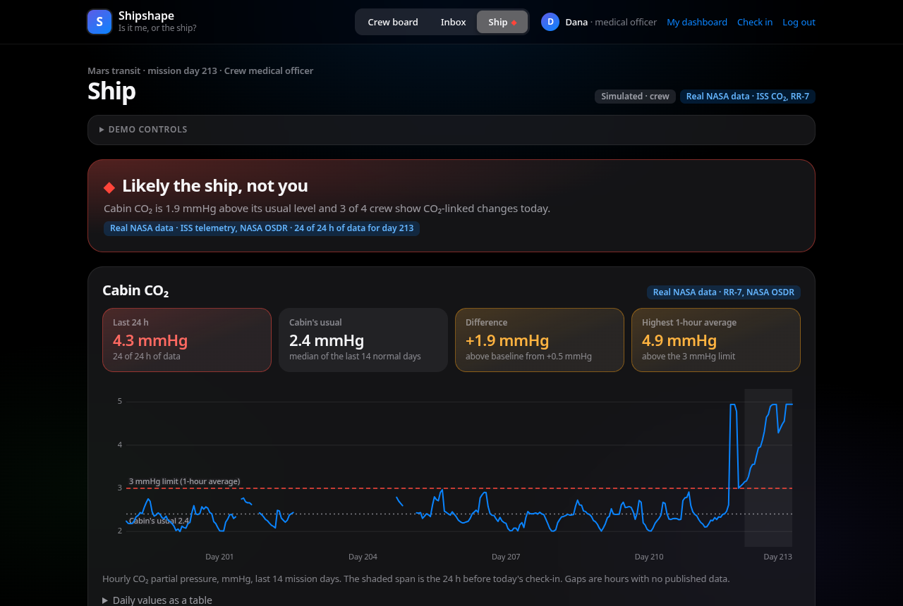
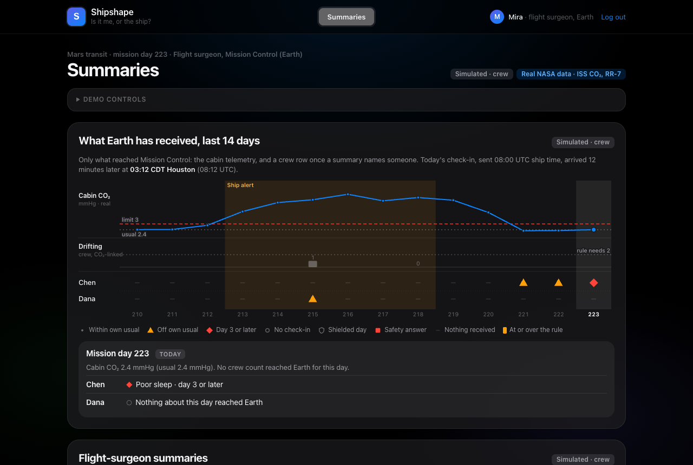

# Ship Or Me?

When several crew members sleep badly or get headaches at once, the cause may not be them. It may be the ship: on the ISS, reported headaches rose with cabin CO₂ ([Law et al. 2014](https://pubmed.ncbi.nlm.nih.gov/24806559/)).

The app compares each astronaut's check-in and wearable readings with their own normal, checks real ISS cabin telemetry (from NASA's Open Science Data Repository) against NASA-STD-3001 limits, and answers one question: is it me, or the ship?

We tested the rules on 200 simulated crews over 10 real ISS cabin traces:

- On days with a CO₂ rise, 74% of alerts named the ship.
- 95% of one person's own problems were correctly not put down to the ship.
- During CO₂ rises it opened 72% fewer personal cases than an app with one alert per person.

The app works offline with no server and no AI model. It says "likely" and never diagnoses. The same approach carries over to Antarctic winter stations, submarines and other closed habitats.

Built for the NASA Space Apps Challenge 2026, "Create Health Monitoring Software for Astronauts on Space Missions". It grew from the team's [plan v0.1](docs/plan-v0.1.md), now superseded by [docs/SPEC.md](docs/SPEC.md).

## For judges

- **Live demo: [ship-or-me.vercel.app](https://ship-or-me.vercel.app/)**, installable and offline-capable.
- **The challenge page opens each screen in one click,** no PIN to type, logged in as the person who would see it. The golden path: day 213 "likely the ship" (as Dana, the medical officer), day 221 "likely you" (Chen's own dashboard), day 223 "day 3 reaches Earth" (Mira, the flight surgeon), then the crew's Guide (Chen).
- **How it answers the challenge:** the `/challenge` page, no login: the five questions, the evidence and the limits.
- **The crew's Guide** (`/guide`, the book button on the dashboard): plain explanations of every reading, why it matters in space and NASA's limit, with a search that understands everyday words ("head hurts"). Its sources are not shown to the crew; every one is listed in [docs/CITATIONS.md](docs/CITATIONS.md), and a sentence appears only after a person on the team has opened its source.

| Real | Simulated | Estimated |
| --- | --- | --- |
| ISS cabin CO₂, temperature and humidity from NASA's Open Science Data Repository (mission RR-7 in the demo, 10 missions in the backtest; source in the demo dock's "About the data", SHA-256 in `scripts/snapshots/SHA256SUMS`), NASA-STD-3001's 3 mmHg CO₂ limit and its temperature and humidity ranges, and published results for real ISS crews (sleep, headaches) set beside the simulated crew | The four-person crew and their wrist-wearable readings (sleep, exercise, heart rate, HRV, blood oxygen, breathing, skin temperature), seeded and simulated (stated in the demo dock's "About the data", not labelled on each screen) | Radiation dose for the mission setting, from published measurements, against NASA's 600 mSv career limit |

**Evidence**: 200 simulated crews over 10 real ISS cabin traces, run through the app's own rules ([SPEC, "Evidence"](docs/SPEC.md#evidence)):

- On days with a CO₂ rise the rule says "the ship" in 74% of alerts; on days with one person's own problem it says "not the ship" in 95% (90% pooled).
- Across 416 real ISS days, CO₂ was a suspect on 63 and over NASA's limit on 29; temperature left NASA's comfort range on 4 and humidity on none. On the ISS, CO₂ is the cabin factor that moves; the other two are ruled out by name.
- During CO₂ rises it opens 72% fewer personal cases than an app with one alert per person, and sends 87% fewer individual summaries to the flight surgeon.
- A slow mood decline that never jumps on any one day: 94% are flagged against the person's starting normal, and 93% reach the flight surgeon (9% without that check).
- The known blind spot, stated on the challenge page: a personal problem that starts during a ship alert is put down to the ship until the air recovers (8 of 32 such events never got a personal label).
- The simulated crews beside real ISS crews: headache days 2.1% against NASA's 2.7%; sleep 7.2 h against about 6.5 h, which we state rather than hide.
- Every reading links to the NASA Human System Risk it informs, on the challenge page.

| | |
| --- | --- |
|  |  |
|  |  |

Not a medical device: it says "likely", never diagnoses, and supports the flight surgeon rather than replacing one. No AI model runs in the product, there is no leaderboard and no backend; the PIN login runs in the browser only (see below). AI use during development is in [docs/AI_USE_LOG.md](docs/AI_USE_LOG.md).

## Run it

```bash
npm install
npm run dev        # http://localhost:5173  (login; then /dashboard, /checkin and /app)
npm test           # unit tests for the rules
npm run build      # production build, installable and offline-capable
```

### Log in

The start page is the login: pick a person and enter their PIN on the on-screen keypad (or type it); it is printed on their card. The **judge's tour** starts from the "Judge's tour" button on [/challenge](https://ship-or-me.vercel.app/challenge): five stops that walk the demo (day 213 as Dana, day 221 as Chen, day 223 as Mira on Earth, the Guide as Chen, and the challenge page), each logging in with that person's demo PIN for you. These are demo PINs:

| Person | Role | PIN |
| --- | --- | --- |
| Anna | Astronaut | 1111 |
| Ben | Astronaut | 2222 |
| Chen | Astronaut | 3333 |
| Dana | Medical officer | 4444 |
| Mira | Flight surgeon, Mission Control (Earth) | 5555 |

Every crew member gets their own dashboard and their own check-in at /checkin (check-in, reaction test, conference requests), and nobody else's. The crew app at /app is the medical console: Dana opens it as the crew medical officer, and Mira, the flight surgeon, sees everything the crew medical officer sees plus the summaries sent to Earth. Astronauts cannot open /app. Mira is not crew, so has no dashboard and no check-in. Nobody can view as another crew member. The challenge page at /challenge needs no login.

The login is a privacy gate for a demo, not security: there is no server, so anyone can read `public/data/accounts.json` and try all 10 000 PINs offline. It stores a salted PBKDF2 hash per person, never the PIN. A session lasts until the tab closes (at most 8 hours); five wrong PINs lock that person out for 30 s, doubling each time.

### Pages

- **/dashboard**: the logged-in person's dashboard on a 3D skeleton. Zones turn orange when something drifts from their own normal and red when it lasts to day 3 or cabin CO₂ is over the limit. Its demo days are the crew app's: 212 (CO₂ starts to climb), 213 (cabin high, Chen fine), 221 (air normal, Chen still off) and 223 (day 3); `?day=221` opens a specific day. Chen (PIN 3333) is the one to follow. Tap a vital tile to open it larger, with ranges from one day to the whole mission so far and the flagged days marked.
- **/challenge** (no login): how the demo answers the challenge's five questions, the backtest evidence and the Antarctic case. Each answer has a button that opens the screen that shows it.
- **/checkin**: the logged-in crew member's morning check-in. Their status against their own normal is on their dashboard. The check-in takes about a minute: a simulated wearable measures last night's sleep and yesterday's exercise, so they are never asked, and the person taps five 0-10 ratings (sleep quality, fatigue, irritability, stress, mood) and their symptoms. From the check-in they can also ask for a conference with the flight surgeon, routine or urgent. The wearable's heart rate, HRV, blood oxygen, breathing and skin temperature are shown for information on the dashboard; no rule uses them yet.
- **/app**: the crew app, for Dana and Mira. Use the **demo dock** at the bottom of the screen: day 212 (all OK), 213 (CO₂ rises, "Likely the ship, not you"), 221 (air back to normal, one person still off), 223 (day 3, summary to the flight surgeon). **Mission**, under the dock's settings button, switches between the ISS, the lunar surface, Mars transit and an Antarctic station; it changes the delay to Earth and the radiation card on the Ship screen, never the rules. The crew board's **crew timeline** shows 14 days of cabin CO₂, how many crew drift, and a row per person; tap a day to read it. Log in as Mira for the same screens plus **Summaries**: on day 223 Chen's day-3 summary arrives, with times in Houston.

## Rebuild the data

Needs Python 3.10+ (standard library only) and network access for the first step.

```bash
npm run data:snapshot   # download ISS telemetry from NASA OSDR, write snapshots and checksums
npm run data:crew       # generate the seeded demo crew
npm run data:backtest   # 200 simulated crews through the app's own engine
npm run data:accounts   # demo login accounts (new random salts each run)
python3 scripts/snapshot_eda.py --verify
```

## Layout

```
src/engine/    baseline.ts  deviation.ts  shipOrMe.ts  escalation.ts  privacy.ts  gravity.ts  mission.ts  config.ts
src/ui/        CrewBoard  CrewTimeline  ShipAlert  FollowUp  Radiation  Medical  CheckInScreen  ReactionTest  Challenge  DemoSettings  DemoDock  Toolbar  ErrorBoundary
src/auth/      Login  TourLink  RequireUser  demo.ts  pin.ts  session.ts  paths.ts
src/dashboard/ Dashboard  SkeletonView  ChartSheet  model.ts  history.ts
src/guide/     Guide  entries.ts  search.ts
src/data/      types.ts  wearable.ts
scripts/       snapshot_eda.py  simulate_crew.py  backtest.py  make_accounts.py  engine_cli.ts  snapshots/
public/data/   cabin.json  crew.json  backtest.json  accounts.json
tests/         engine  golden  checkin  wearable  gravity  mission  auth  dashboard  history  text  guide  (*.test.ts)
docs/          SPEC.md  CITATIONS.md  AI_USE_LOG.md  adr/  research/
```

`docs/SPEC.md` has the JSON shapes, every rule, the readings of the plan that this build chose, and the open items.

## Team

- Filip Kolar
- Frantisek Kares
- Ales Struhar

## License

To be decided.
