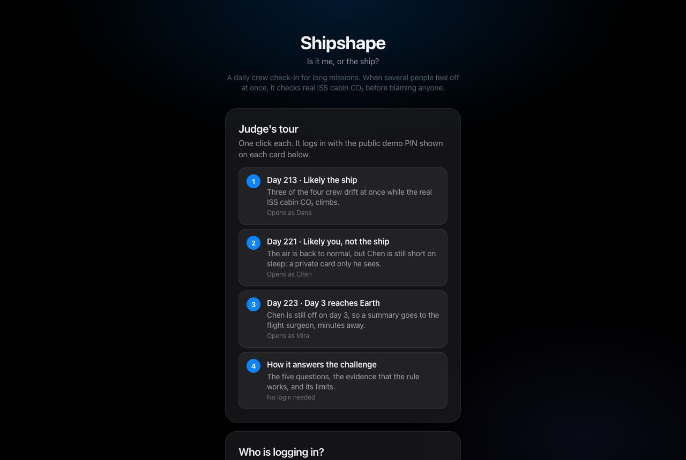
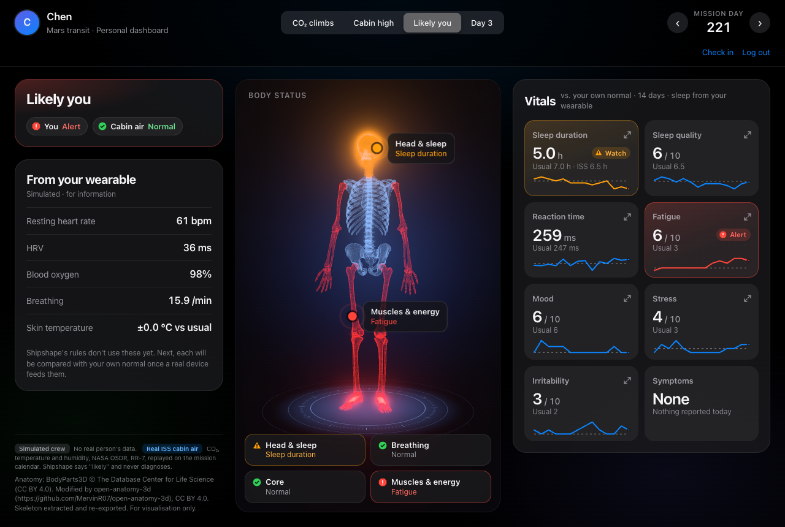

# Shipshape

**Is it me, or the ship?** A daily check-in for a crew on a long mission. When several people feel off at once, Shipshape checks real ISS cabin CO₂ before blaming anyone, and tells each astronaut whether a bad day is likely them or the ship. It rewards honest reporting, never the reading.

Built for the NASA Space Apps Challenge 2026, "Create Health Monitoring Software for Astronauts on Space Missions". It grew from the team's [plan v0.1](docs/plan-v0.1.md), now superseded by [docs/SPEC.md](docs/SPEC.md).

## For judges

- **Live demo: [shipshape-rho.vercel.app](https://shipshape-rho.vercel.app/)**, installable and offline-capable.
- **The start page is a judge's tour.** One click per step, no PIN to type: day 213 "likely the ship" (as Dana, the medical officer), day 221 "likely you" (Chen's own dashboard), day 223 "day 3 reaches Earth" (Mira, the flight surgeon).
- **How it answers the challenge:** the `/challenge` page, no login: the five questions, the evidence and the limits.

| Real | Simulated | Estimated |
| --- | --- | --- |
| ISS cabin CO₂, temperature and humidity from NASA's Open Science Data Repository (mission RR-7; source, API URL and SHA-256 on screen), and the NASA-STD-3001 3 mmHg limit | The four-person crew and their wrist-wearable readings (sleep, exercise, blood oxygen), seeded and labelled as simulated on every screen | Radiation dose for the mission setting, from published measurements, against NASA's 600 mSv career limit |

**Evidence**: 200 simulated crews over 10 real ISS CO₂ traces, run through the app's own rules ([SPEC, "Evidence"](docs/SPEC.md#evidence)):

- The rule names the right cause, ship or not, in 90% of the alerts raised during an event.
- During CO₂ rises it opens 72% fewer personal cases than an app with one alert per person, and sends 87% fewer individual summaries to the flight surgeon.
- A slow mood decline that never jumps on any one day: 94% are flagged against the person's starting normal, and 93% reach the flight surgeon (9% without that check).
- The known blind spot, stated on the challenge page: a personal problem that starts during a ship alert is put down to the ship until the air recovers (8 of 32 such events never got a personal label).

| | |
| --- | --- |
|  |  |
|  |  |

Not a medical device: it says "likely", never diagnoses, and supports the flight surgeon rather than replacing one. No AI model runs in the product, there is no leaderboard and no backend; the PIN login runs in the browser only (see below). AI use during development is in [docs/AI_USE_LOG.md](docs/AI_USE_LOG.md).

## Run it

```bash
npm install
npm run dev        # http://localhost:5173  (login; then /dashboard and /app)
npm test           # unit tests for the rules and the game
npm run build      # production build, installable and offline-capable
```

### Log in

The start page opens with a **judge's tour**: four links that walk the demo (day 213 as Dana, day 221 as Chen, day 223 as Mira on Earth, and the challenge page). Each logs in with that person's demo PIN for you. To log in by hand, pick a person and type their PIN; it is printed on their card. These are demo PINs:

| Person | Role | PIN |
| --- | --- | --- |
| Anna | Astronaut | 1111 |
| Ben | Astronaut | 2222 |
| Chen | Astronaut | 3333 |
| Dana | Medical officer | 4444 |
| Mira | Flight surgeon, Mission Control (Earth) | 5555 |

Every crew member gets their own dashboard and nobody else's. Everyone can open the crew app at /app, in their own view: astronauts as themselves (check-in, reaction test, quests), Dana as the crew medical officer or as herself. Nobody can view as another crew member. Mira is not crew, so has no dashboard; that login opens /app fixed to the flight surgeon's view, which shows only what was sent to Earth. The challenge page at /challenge needs no login.

The login is a privacy gate for a demo, not security: there is no server, so anyone can read `public/data/accounts.json` and try all 10 000 PINs offline. It stores a salted PBKDF2 hash per person, never the PIN. A session lasts until the tab closes (at most 8 hours); five wrong PINs lock that person out for 30 s, doubling each time.

### Pages

- **/dashboard**: the logged-in person's dashboard on a 3D skeleton. Zones turn orange when something drifts from their own normal and red when it lasts to day 3 or cabin CO₂ is over the limit. Its demo days are the crew app's: 212 (CO₂ starts to climb), 213 (cabin high, Chen fine), 221 (air normal, Chen still off) and 223 (day 3); `?day=221` opens a specific day. Chen (PIN 3333) is the one to follow. Tap a vital tile or the cabin CO₂ chart to open it larger, with ranges from one day to the whole mission so far and the flagged days marked.
- **/challenge** (no login): how the demo answers the challenge's five questions, the backtest evidence and the Antarctic case. Each answer has a button that opens the screen that shows it.
- **/app**: the crew app. Its check-in takes under a minute: a simulated wrist wearable fills in sleep, sleep quality, exercise and blood oxygen, and the person rates how they feel. Use the **Golden path** control: day 212 (all OK), 213 (CO₂ rises, "Likely the ship, not you"), 221 (air back to normal, one person still off), 223 (day 3, summary to the flight surgeon). **Viewing as** switches the medical officer between the crew medical officer and herself. **Mission** switches between the ISS, the lunar surface, Mars transit and an Antarctic station; it changes the delay to Earth and the radiation card on the Ship screen, never the rules. The crew board's **crew timeline** shows 14 days of cabin CO₂, how many crew drift, and a row per person; tap a day to read it. Log in as Mira and step through the golden path: Earth sees no names during the CO₂ event, and Chen's row appears on day 223 when the day-3 summary is sent, with times in Houston.

## Rebuild the data

Needs Python 3.10+ (standard library only) and network access for the first step.

```bash
npm run data:snapshot   # download ISS telemetry from NASA OSDR, write snapshots and checksums
npm run data:crew       # generate the seeded demo crew
npm run data:backtest   # 200 simulated crews through the app's own engine
npm run data:accounts   # demo login accounts (new random salts each run)
python3 scripts/snapshot_eda.py --verify
```

## Layout

```
src/engine/   baseline.ts  deviation.ts  shipOrMe.ts  escalation.ts  privacy.ts  config.ts  mission.ts
src/game/     xp.ts  streak.ts  quests.ts
src/ui/       CrewBoard  CheckInScreen  MeView  ShipAlert  Radiation  About  Medical  CrewTimeline  RoleSwitcher
src/auth/     Login  RequireUser  pin.ts  session.ts  paths.ts
src/dashboard/ Dashboard  SkeletonView  ChartSheet  model.ts  history.ts
scripts/      snapshot_eda.py  simulate_crew.py  backtest.py  make_accounts.py  engine_cli.ts  snapshots/
public/data/  cabin.json  crew.json  backtest.json  accounts.json
tests/        engine.test.ts  game.test.ts  mission.test.ts  auth.test.ts  history.test.ts
docs/         SPEC.md  CITATIONS.md  AI_USE_LOG.md
```

`docs/SPEC.md` has the JSON shapes, every rule, the readings of the plan that this build chose, and the open items.

## Team

- Filip Kolar
- Frantisek Kares

## License

To be decided.
